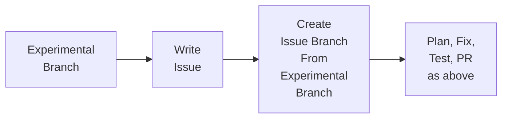

# Videos: branch, plan and fix

Six short videos showing the workflow in `AGENTS.md`. Text in quotes is what
to type to the agent. Keep the issue and the project board open in a browser
tab while recording.

## The flow

### Fixing an issue

### Experimenting, then keeping it

The experiment branch is kept, so you can carry on experimenting afterwards.

## Series 1: Fixing an issue

### 1. The idea and the issue (about 5 min)

- Show `AGENTS.md` and the project board.
- Explain the flow in one sentence: issue, branch, plan, fix, pull request,
  merge.
- On GitHub, write the issue "Add a docs/about.md page that describes the
  project", with two acceptance criteria:
  - the file exists
  - it says what PRISM LCA is in one or two sentences
- Assign it to yourself and show it on the board.

### 2. Branch and plan (about 5 min)

- Type "can you get my issues for this repo", then "let's work on #N".
- The agent shows the issue and asks whether to start. Say yes. It explains
  that it's creating `issue-N-branch` because each issue gets its own branch.
- Point out the branch name in VS Code's status bar (bottom left).
- The agent drafts `plans/issue-N-plan.md`. Open it and read through it.
- Edit something on camera, then approve it.
- The agent commits and pushes the plan. Show the branch and the plan on
  GitHub.
- Point to make: no code is written until the plan is approved.

### 3. Fix, test, pull request, merge, clean up (about 6 min)

- The agent writes the page and pushes commits starting with `#N:`.
- Test it yourself: open the file on GitHub on the branch and check each
  acceptance criterion.
- Optional: change your mind about the content and show the plan being
  updated first, then the page.
- The agent asks how you tested it, then opens the pull request. Show
  `Fixes #N`, the plan link and the Commits tab.
- Merge it. Show:
  - the issue closing
  - the board moving it to Done, with the PR in the Linked pull requests
    column
  - the branch disappearing on GitHub
- The agent switches to `main`, pulls and deletes the local branch.

## Series 2: Experimenting, then keeping it

### 4. Experiment freely (about 4 min)

- In VS Code, click the branch name (bottom left), choose
  **Create new branch** and call it `try-welcome-page`.
- Add a rough `docs/welcome.md` with a few lines.
- Commit it in the Source Control panel with any message, then push.
- Point to make: no issue and no plan, and never a pull request from an
  experiment branch.

### 5. Decide to keep it (about 5 min)

- On GitHub, write the issue "Add a welcome page" with acceptance criteria,
  and assign it to yourself.
- Type "I want to keep my try-welcome-page experiment, the issue is #M".
- The agent brings the experiment up to date with `main` and copies it to
  `issue-M-branch`, explaining that it's a copy.
- It drafts the plan, starting from what the experiment already does.
  Approve it. It's committed after the experiment's commits.
- Show both branches in VS Code's branch list.

### 6. Finish it, and the experiment lives on (about 5 min)

- The agent tidies the page in `#M:` commits. Test it yourself.
- The agent opens the pull request with `Fixes #M`. Merge it.
- Show `issue-M-branch` deleted on GitHub while `try-welcome-page` is still
  there.
- Switch to `try-welcome-page`, make one more change and commit it.
- Point to make: to keep more later, write a new issue and the agent copies
  the experiment again.

## Resetting between takes

Ask the agent to delete the files a run added (for example `docs/about.md`)
and commit that directly to `main`. Only a code owner can ask for that.
