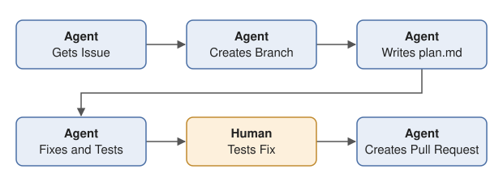
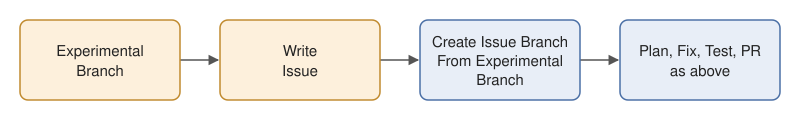

# PRISM LCA — Branch, Plan, and Fix

Oct 17, 2026 · Calvin, Elena

## Branch, plan, and fixing issues

Every issue is fixed on its own branch, named with the issue number:
`issue-23-branch` for issue #23. An approved plan is committed before the fix.
Then a pull request goes to Elena or Calvin, who review and merge it.

### The steps



1. **Assign.** Elena or Calvin assigns the issue to one person. It appears on
   the project board.
2. **Branch.** The agent shows the owner the issue and asks whether to start.
   Once they say yes, it creates `issue-23-branch` from an up-to-date `main`
   and explains that each issue gets its own branch.
3. **Plan.** The agent reads the issue and the code and drafts
   `plans/issue-23-plan.md` from the template below, without changing any
   code. The owner reads the plan and edits it until they're happy, then
   approves it. The agent commits and pushes it.
4. **Fix.** On the same branch, the agent makes the change in small commits,
   each starting with the issue number (for example
   `#23: close open menu on window resize`), and pushes as it goes. The owner
   then tests each acceptance criterion by hand: they run the app or the
   calculation and check it themselves.
   - If the plan turns out to be wrong, the plan is updated first, then the
     code. The plan always describes what was actually built.
5. **Pull request.** The agent opens a PR from `issue-23-branch` into `main`.
   The description includes `Fixes #23`, a link to the plan, and a short note
   on how the owner tested it. The agent asks the owner how they tested it
   rather than guessing.
6. **Review and merge.** Elena or Calvin review the PR against the plan. The
   PR's Commits and Files changed tabs show exactly what changed. Requested
   changes become more commits on the same branch. Use the branch only for
   this PR; new work gets its own branch. When they approve, they merge, and
   then:
   - the issue closes automatically (because of `Fixes #23`)
   - on the project board, the issue moves to Done with the PR shown in the
     Linked pull requests column
   - GitHub deletes the branch on GitHub
   - the plan stays in `plans/` as the record of why the change was made
7. **Clean up.** The agent switches back to `main`, pulls, and deletes the
   local copy of the branch (`git branch -d issue-23-branch`).

### A real example: issue #32

This is the practice run in `prism-practice-repo`:

1. Issue #32 asked for a new page, `docs/calvin.md`.
2. The agent created `issue-32-branch` and drafted `plans/issue-32-plan.md`.
   Calvin approved it, and it became the branch's first commit.
3. The agent added the page. Calvin then decided the page should just say
   "Hello from Calvinw", so the agent updated the plan first and then the
   page.
4. Calvin checked the page on GitHub on `issue-32-branch`. The agent ticked
   the acceptance criteria and opened PR #33 with `Fixes #32` and that
   testing note.
5. When PR #33 was merged, issue #32 closed, the board showed it as Done with
   PR #33 linked, and GitHub deleted `issue-32-branch`. The agent deleted the
   local copy.

## Experiments

Anyone can experiment on a branch without an issue, for example `dark-mode`.
Commit as often as you like. An experiment branch is never merged into `main`
with a pull request; only a code owner can merge one directly.

When you want to keep some of the work:



1. **Write an issue** for it, say #40, as for any other change.
2. **The agent copies the branch.** It brings `dark-mode` up to date with
   `main`, then creates `issue-40-branch` from it. `dark-mode` stays as it is.
3. **Carry on from step 3 (Plan) above.** The plan is committed after the
   experiment's commits, then the fix, the PR with `Fixes #40`, review and
   merge.

After the merge, GitHub deletes `issue-40-branch` but keeps `dark-mode`, so
you can keep experimenting. Next time you want to keep something, write a new
issue (#45) and the agent copies `dark-mode` to `issue-45-branch` the same
way.

## Plan template

```markdown
# Plan for issue #23: <issue title>
Branch: issue-23-branch · Owner: …

## Goal
(one or two sentences: what's wrong, or what we want, and why)

## Acceptance criteria
(copied from the issue: things someone can check yes or no)
- [ ] …
- [ ] …

## What will change
(a short, plain-language summary anyone on the team can follow)

## Testing steps
(numbered steps a person follows by hand to check each acceptance criterion)
```

Write the plan in plain language: the owner and reviewers may not be
programmers. When the fix is done, tick the acceptance criteria the owner has
confirmed.

## Sample plan

A made-up example for a navbar bug, as it would look after the fix is done.

```markdown
# Plan for issue #23: Navbar menus overlap when the window is resized
Branch: issue-23-branch · Owner: Elena

## Goal
When the window is resized, the navbar menus (File, Results, Product)
overlap each other and the page below. Menus should open one at a time
and always fit cleanly on screen.

## Acceptance criteria
- [x] Opening one menu closes any other open menu.
- [x] Resizing the window with a menu open closes it, with no leftover overlap.
- [x] At 1440, 768 and 375 px wide, every menu opens fully on screen
      and covers nothing else in the navbar.

## What will change
Right now each menu decides on its own whether it is open, so two can be
open at once, and nothing closes them when the window changes size.
The navbar will keep track of which one menu is open, close it when the
window is resized, and nudge any menu near the edge of the screen back
into view.

## Testing steps
1. Run the app (npm run dev) in a desktop browser at full width.
2. Open File, then click Results: File closes and only Results is open.
3. With Results open, drag the window narrower: the menu closes cleanly.
4. Use the browser's device toolbar at 768 px and 375 px wide and
   open each menu: each fits on screen and overlaps nothing.
5. Repeat step 3 on a phone or tablet by rotating the screen.
```

## Teams

| Team | Covers | Main repo |
| :--- | :--- | :--- |
| Product & UI | Screens, workflows, the AI chat panel, responsive design | `product-graph-editor` |
| Engine & Data | Calculation engine, MCP/REST server, background databases, import/export, deployment | `life-cycle-assessment-mcp` |
| Product Design, Testing & Docs | Case studies, tests and CI, documents and skills | `lca-mock-tests`, `agentic-lca` |
